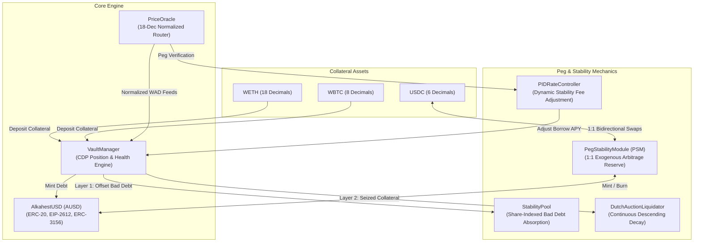
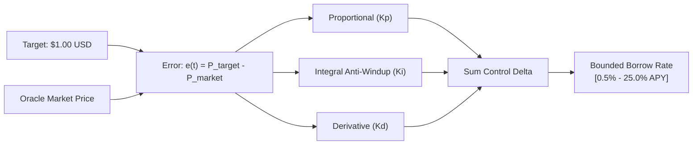
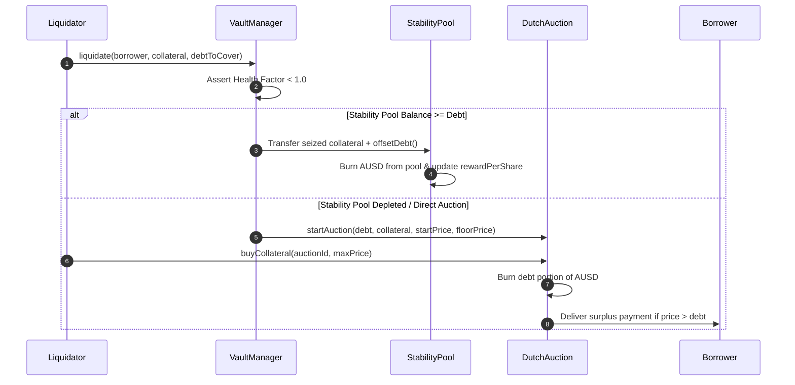

# AlkahestMint: Multi-Collateral Non-Custodial Algorithmic Stablecoin Protocol

[](https://github.com/ZengLLQ/alkahest-mint/actions/workflows/ci.yml)
[](https://soliditylang.org/)
[](https://getfoundry.sh/)
[](LICENSE)

**AlkahestMint** is a decentralized, non-custodial, multi-collateral stablecoin protocol engineered in Solidity (v0.8.28) and tested with Foundry. Named after the mythical universal solvent of alchemy, AlkahestMint dissolves multi-asset collateral (e.g., WETH, WBTC, staked assets) into a unified, capital-efficient synthetic sovereign dollar ($AUSD$). 

The protocol incorporates an **Adaptive Discrete PID Stability Fee Controller**, **Dual-Layer Liquidation Architecture** (combining a zero-latency Stability Pool with a continuous descending Dutch Auction fallback), a **Peg Stability Module (PSM)** for deterministic 1:1 arbitrage, and native **ERC-3156 Flash Minting**.

---

## Architectural Overview



---

## Mathematical Foundations

### 1. Collateralized Debt Positions & Health Factors

Each borrower locks collateral $C_i$ with an asset-specific liquidation threshold $\text{LT}_i \in [0, 10000]$ (basis points) and maximum loan-to-value $\text{LTV}_i$. The health factor $\mathcal{H}$ measures solvency relative to total compounded debt:

$$\mathcal{H} = \frac{\sum_{i} C_i \times P_i \times \text{LT}_i}{\text{Debt}_{\text{total}}}$$

Where:
- $C_i$: Collateral balance normalized to $10^{18}$ WAD precision ($C_i \cdot 10^{18 - \text{dec}_i}$).
- $P_i$: Asset price normalized to $10^{18}$ USD via `PriceOracle`.
- A position is solvent if $\mathcal{H} \ge 1.0 \times 10^{18}$ and becomes liquidatable when $\mathcal{H} < 1.0 \times 10^{18}$.

### 2. Continuous Compound Interest Accrual

Debt is normalized into debt shares $S_d$ scaled by a continuous cumulative borrow index $I(t)$ initialized at $10^{27}$ RAY:

$$\text{Debt}(t) = \frac{S_d \times I(t)}{10^{27}}$$

$$I(t) = I(t_0) \times \left(1 + r_{\text{borrow}}\right)^{\Delta t}$$

High-precision binomial expansion approximates per-second compounding without exponentiation overflow.

### 3. Adaptive Discrete PID Peg Controller

To keep $AUSD$ bound to $\$1.00$, the protocol dynamically modulates the base borrow fee $r_{\text{borrow}}(t)$ through a discrete Proportional-Integral-Derivative (PID) feedback loop reacting to market price error $e(t) = P_{\text{target}} - P_{\text{market}}$:

$$r_{\text{stability}}(t) = r_{\text{base}} + K_p e(t) + K_i \int e(\tau) d\tau + K_d \frac{de(t)}{dt}$$



- **When $P_{\text{market}} < \$1.00$ ($e(t) > 0$):** Stability fees increase, disincentivizing borrowing and encouraging debt repayments to contract circulating supply.
- **When $P_{\text{market}} > \$1.00$ ($e(t) < 0$):** Stability fees decline, incentivizing CDP borrowing to expand circulating supply.

### 4. Dual-Layer Liquidation Mechanics



#### Layer 1: Stability Pool $O(1)$ Debt Absorption
Liquidity providers stake $AUSD$ in the `StabilityPool`. When an undercollateralized vault is liquidated, the pool atomically absorbs bad debt, burning $AUSD$ and distributing seized collateral with a liquidation bonus:

$$\Delta S_{\text{collateral}} = \frac{C_{\text{reward}} \times 10^{18}}{\text{TotalShares}_{\text{pool}}}$$

$$\text{ClaimableReward} = \frac{\text{UserShares} \times (S_{\text{current}} - S_{\text{snapshot}})}{10^{18}}$$

#### Layer 2: Continuous Descending Dutch Auction
If the stability pool is depleted or bypassed, collateral is auctioned via a linear decay Dutch auction:

$$P(t) = P_{\text{start}} - \left(P_{\text{start}} - P_{\text{floor}}\right) \times \min\left(1, \frac{t - t_{\text{start}}}{T_{\text{duration}}}\right)$$

### 5. Peg Stability Module (PSM)

The `PegStabilityModule` guarantees hard peg boundaries by enabling instant 1:1 conversions between exogenous reserves (e.g. USDC) and $AUSD$, minus fixed basis-point mint/redeem fees:

$$\text{AUSD}_{\text{out}} = \left(\text{USDC}_{\text{in}} \times 10^{12}\right) \times \left(1 - \frac{\text{Fee}_{\text{mint}}}{10000}\right)$$

---

## Contract Layout

| Contract | Path | Role |
| :--- | :--- | :--- |
| **`AlkahestUSD`** | [`src/tokens/AlkahestUSD.sol`](src/tokens/AlkahestUSD.sol) | Synthetic sovereign dollar token with EIP-2612 permit & ERC-3156 flash minting. |
| **`VaultManager`** | [`src/vault/VaultManager.sol`](src/vault/VaultManager.sol) | Core CDP engine managing collateral deposits, borrowing, interest index, and health checks. |
| **`StabilityPool`** | [`src/stability/StabilityPool.sol`](src/stability/StabilityPool.sol) | Liquidity pool for zero-latency bad debt absorption and pro-rata collateral reward distribution. |
| **`DutchAuctionLiquidator`** | [`src/auction/DutchAuctionLiquidator.sol`](src/auction/DutchAuctionLiquidator.sol) | Continuous linear descending Dutch auction engine for seized collateral. |
| **`PegStabilityModule`** | [`src/psm/PegStabilityModule.sol`](src/psm/PegStabilityModule.sol) | 1:1 arbitrage engine between exogenous stablecoins (USDC) and AUSD. |
| **`PIDRateController`** | [`src/controller/PIDRateController.sol`](src/controller/PIDRateController.sol) | Closed-loop PID controller regulating stability borrow rates. |
| **`PriceOracle`** | [`src/oracle/PriceOracle.sol`](src/oracle/PriceOracle.sol) | 18-decimal normalized price router with staleness detection. |
| **`MathLib`** | [`src/libraries/MathLib.sol`](src/libraries/MathLib.sol) | High-precision WAD/RAY arithmetic and binomial compound interest functions. |
| **`PIDLib`** | [`src/libraries/PIDLib.sol`](src/libraries/PIDLib.sol) | Fixed-point discrete PID mathematical calculations and anti-windup bounds. |

---

## Test & Verification Matrix

The test suite covers unit, fuzz, and system invariant properties:

```text
Ran 7 test suites in 56.46ms: 29 tests passed, 0 failed, 0 skipped (29 total tests)

- AlkahestUSDTest:
  [PASS] test_InitialState()
  [PASS] test_MintAndBurnByOwner()
  [PASS] test_MintUnauthorizedReverts()
  [PASS] test_TransferAndAllowance()
  [PASS] test_EIP2612_Permit()
  [PASS] test_FlashMint_Success()
  [PASS] test_FlashMint_ExceedsCeilingReverts()
  [PASS] test_FlashMint_CallbackFailureReverts()

- VaultManagerTest:
  [PASS] test_DepositCollateral()
  [PASS] test_BorrowUSD_WithinLTV()
  [PASS] test_BorrowUSD_ExceedingLTV_Reverts()
  [PASS] test_RepayUSD_ReducesDebt()
  [PASS] test_WithdrawCollateral_RespectsHealthFactor()
  [PASS] test_AccrueInterest_CompoundsOverTime()

- StabilityPoolTest:
  [PASS] test_StabilityDepositAndWithdraw()
  [PASS] test_LiquidationAbsorptionByStabilityPool()

- DutchAuctionLiquidatorTest:
  [PASS] test_LinearPriceDecay()
  [PASS] test_BuyCollateral_SettlesAndDistributesSurplus()
  [PASS] test_BuyCollateral_ExceedsMaxPriceReverts()

- PegStabilityModuleTest:
  [PASS] test_SwapUSDCForAUSD()
  [PASS] test_SwapAUSDForUSDC()
  [PASS] test_DebtCeilingEnforcement()

- PIDRateControllerTest:
  [PASS] test_InitialState()
  [PASS] test_RateHike_WhenUnderPeg()
  [PASS] test_RateCut_WhenOverPeg()
  [PASS] test_AntiWindupClamping()

- InvariantsTest:
  [PASS] testFuzz_BorrowAlwaysPreservesHealthFactor(uint256,uint256) (runs: 256)
  [PASS] testFuzz_PSM_RoundtripPreservation(uint256) (runs: 256)
  [PASS] testFuzz_StabilityPoolShareConservation(uint256,uint256) (runs: 256)
```

---

## Build & Test Instructions

### Prerequisites
- [Foundry / Forge](https://book.getfoundry.sh/getting-started/installation)

### Build
```bash
git clone https://github.com/ZengLLQ/alkahest-mint.git
cd alkahest-mint
forge build
```

### Run Tests
```bash
# Run unit and fuzz tests
forge test

# Run with verbose gas logs and call traces
forge test -vvv

# Check formatting
forge fmt --check
```

### Local Deployment Simulation
```bash
forge script script/DeployAlkahestMint.s.sol
```

---

## License

This project is licensed under the [MIT License](LICENSE).
